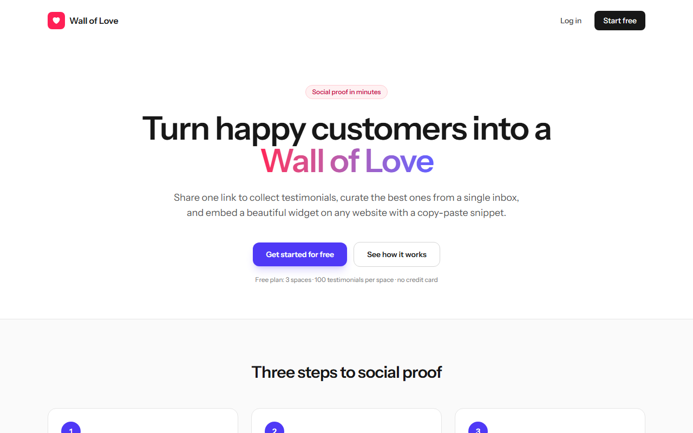
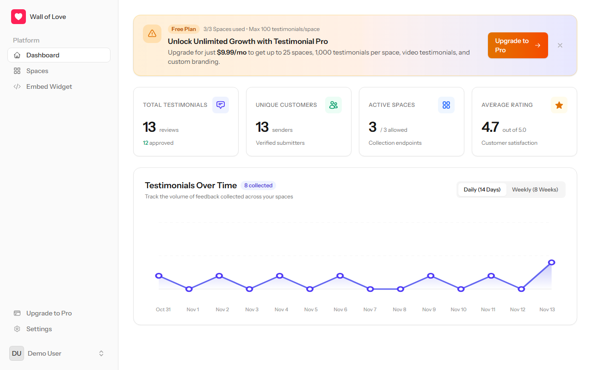
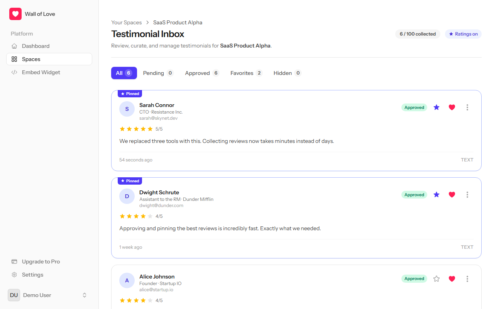
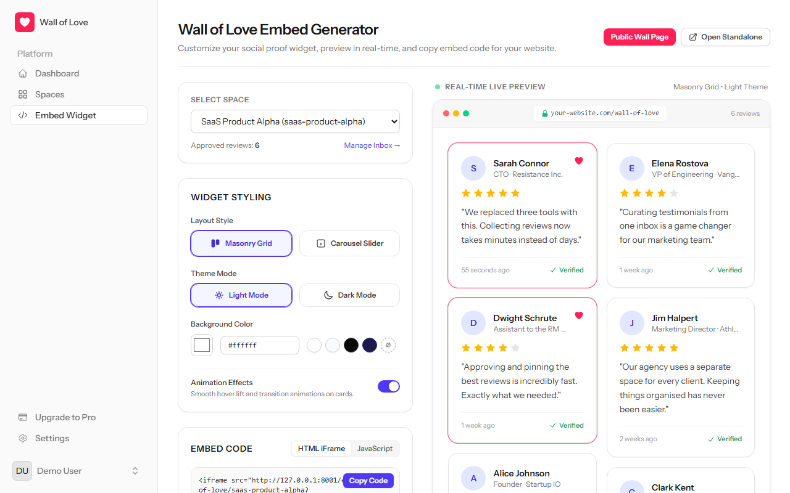
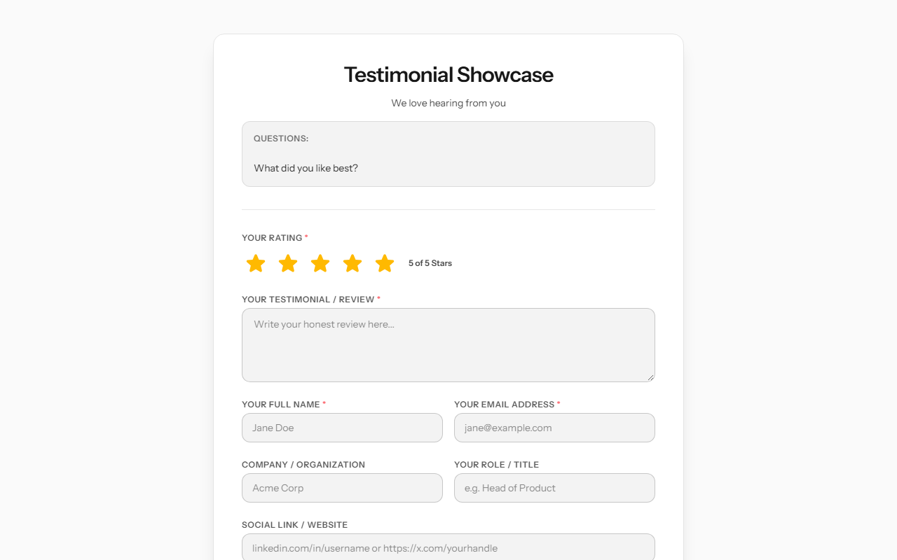
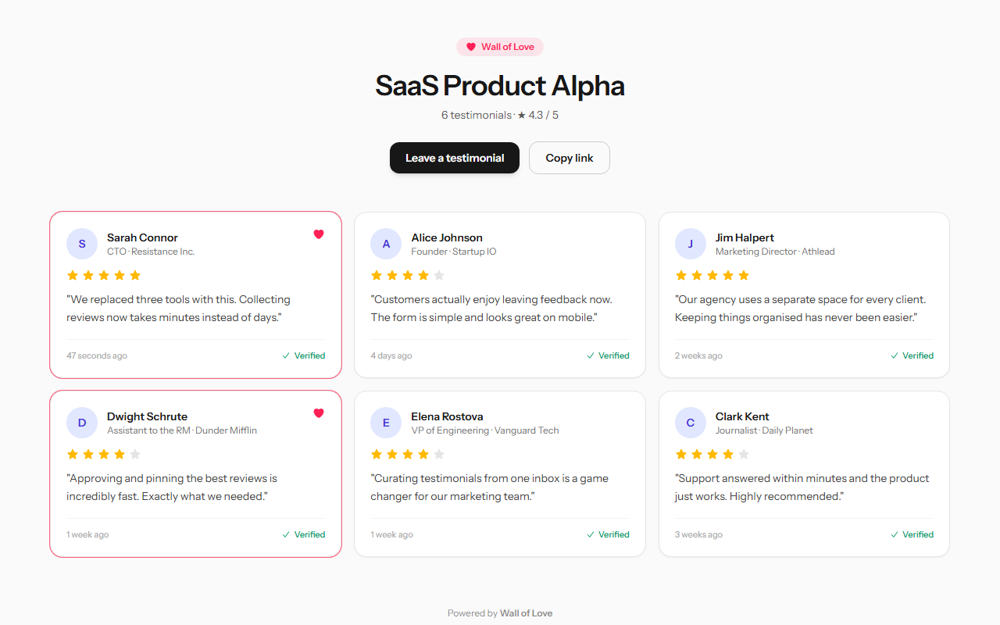
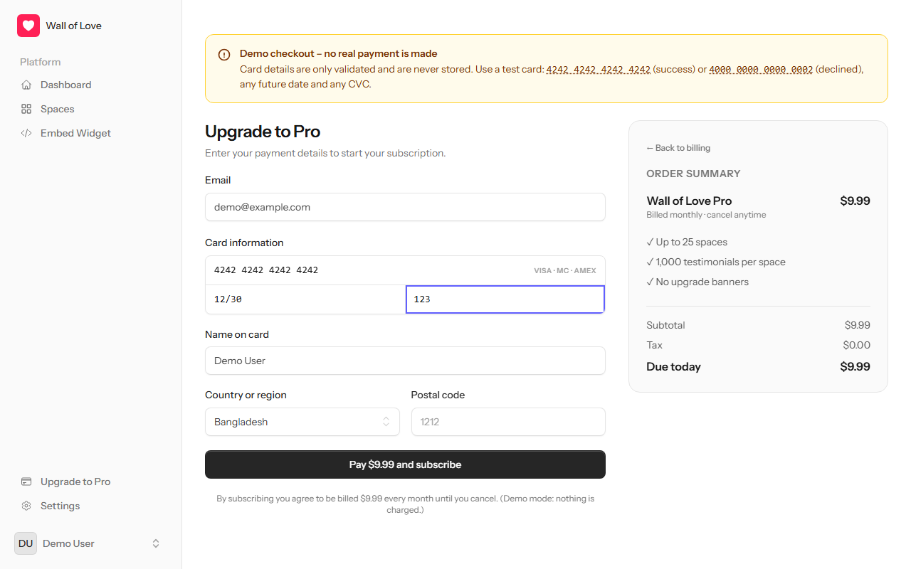
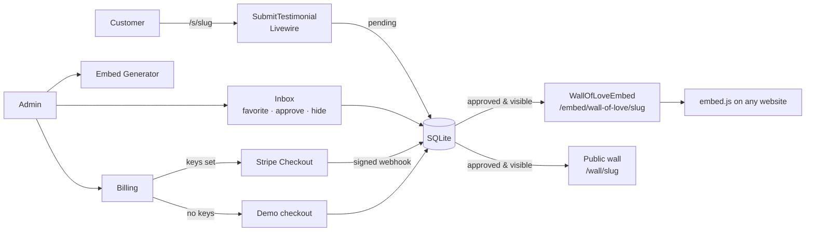

<div align="center">

# 💖 Wall of Love – Testimonial SaaS

**Collect, curate and embed customer testimonials – in minutes.**

Share one link to gather testimonials, approve the best ones from a single inbox, and showcase them
on any website with a beautiful, auto-resizing "Wall of Love" widget.

[](https://github.com/2013rahib-cell/testimonial-app/actions/workflows/tests.yml)


[Features](#features) · [Screenshots](#screenshots) · [Quick start](#quick-start) · [Deployment](#deployment) · [Embedding](#embedding-the-wall-of-love) · [Testing](#testing) · [Architecture](#architecture)

</div>

---

## Overview

Wall of Love is a multi-tenant SaaS application built for the **BS23 Agentic AI Assignment**.
It solves a common problem for businesses: social proof is valuable, but collecting and displaying it is tedious.

| Who | What they do |
|---|---|
| **Business owner (Admin)** | Creates *Spaces* (one per product or campaign), curates submissions, embeds the wall, manages the plan |
| **Customer (Submitter)** | Opens a public link, leaves a rating + testimonial – no account needed |
| **Website visitor** | Sees approved testimonials on the business's website or public wall page |

---

## Features

### Collect
- **Spaces** with custom title, subtitle, question ("ask"), call-to-action and **5 visual themes**
- **Dynamic form fields** – name & email always required; company, social link and profile photo can be shown/required per space; optional ⭐ 5-star rating
- **Public collection page** at `/s/{slug}` – no login, mobile-friendly, mandatory sharing consent, celebratory thank-you screen
- **Spam protection** – server-side validation, rate limiting (10 submissions/hour per visitor per space), image-only uploads ≤ 2 MB

### Curate
- **Inbox** per space with filters: *All · Pending · Approved · Favorites · Hidden*
- ★ **Favorite** to pin, ♥ **Wall of Love** to approve, ⋯ menu to **edit** typos, **hide** or **delete**
- **Dashboard analytics** – total testimonials, unique customers, approved count, average rating and a daily/weekly trend chart

### Showcase
- **Embed generator** with live preview – masonry grid or carousel, light/dark, background colour, animations
- **Copy-paste snippets** – plain `<iframe>` or a lightweight script that auto-resizes to fit
- **Shareable public wall** at `/wall/{slug}`
- Only **approved & non-hidden** testimonials are ever exposed (never emails)

### Monetise
- **Freemium plans** enforced everywhere:

  | Plan | Price | Spaces | Testimonials / space |
  |---|---|---|---|
  | Free | $0 | 3 | 100 |
  | Pro | $9.99 / month | 25 | 1,000 |

- **Stripe Checkout, Billing Portal and signed webhooks** when Stripe keys are configured
- **Built-in demo checkout** until then – full upgrade/cancel flow with test cards, nothing charged or stored

### Account
- Registration, login, password reset, **email verification**, **two-factor authentication** and **passkeys** (Laravel Fortify)
- Profile, appearance (light / dark / system) and security settings

---

## Screenshots

| Landing page | Dashboard |
|---|---|
|  |  |
| **Testimonial inbox** | **Embed generator with live preview** |
|  |  |
| **Public collection form** | **Public Wall of Love** |
|  |  |
| **Demo checkout** | |
|  | |

---

## Tech Stack

| Layer | Technology |
|---|---|
| Backend | **Laravel 13** (PHP 8.4+) |
| UI | **Livewire 4** class components, **Flux UI**, **Tailwind CSS 4**, Alpine.js |
| Auth | **Laravel Fortify** – sessions, email verification, 2FA, passkeys |
| Database | **SQLite** by default (any Laravel-supported database works) |
| Payments | **Stripe** Checkout, Billing Portal, Webhooks (`stripe/stripe-php`) + demo gateway |
| Build | Vite (vite-plus) |
| Quality | PHPUnit 12, Playwright, Larastan (PHPStan), Laravel Pint |
| CI / CD | GitHub Actions → Docker → Render |

---

## Quick Start

### Prerequisites
- **PHP 8.4+** with `pdo_sqlite` (and ideally `intl`)
- **Composer 2**, **Node.js 20+** and npm, **Git**
- *Windows only:* the Microsoft Visual C++ Redistributable (needed by the Vite build tool)
  ```powershell
  winget install Microsoft.VCRedist.2015+.x64
  ```

### Installation

```bash
git clone https://github.com/2013rahib-cell/testimonial-app.git
cd testimonial-app

composer setup        # install deps, create .env + key, migrate, storage:link, build assets
php artisan db:seed   # demo data (safe to run more than once)
php artisan serve     # → http://127.0.0.1:8000
```

Prefer hot-reload while developing? `composer run dev` starts the server, Vite, the queue worker and a log tail together.

### Demo account & data

| | |
|---|---|
| **Login** | `demo@example.com` / `password` (email already verified, Free plan) |
| **Collection form** | http://127.0.0.1:8000/s/test-product |
| **Public wall** | http://127.0.0.1:8000/wall/saas-product-alpha |

> New accounts must verify their email. Locally `MAIL_MAILER=log`, so the verification link is written to
> `storage/logs/laravel.log` (search for `verify-email`).

### Trying the billing flow

Without Stripe keys, **Upgrade to Pro** opens the built-in demo checkout:

| Card number | Result |
|---|---|
| `4242 4242 4242 4242` | ✅ Payment succeeds → account upgraded to **Pro** |
| `4000 0000 0000 0002` | ❌ Card declined |
| `4000 0000 0000 9995` | ❌ Insufficient funds |

Use any future expiry (e.g. `12/30`) and any 3-digit CVC. Pro users can cancel from **Settings → Billing**.
Card details are only validated – they are never stored or sent anywhere.

---

## Configuration

All settings live in `.env` (copied from `.env.example`). Never commit `.env` or real keys.

| Variable | Default | Purpose |
|---|---|---|
| `APP_NAME` | `Wall of Love` | Product name shown in the UI |
| `APP_URL` | `http://localhost:8000` | Base URL used in embed snippets and emails – **set to your public URL in production** |
| `DB_CONNECTION` | `sqlite` | Uses `database/database.sqlite` |
| `MAIL_MAILER` | `log` | Configure SMTP (`MAIL_*`) to send real verification / reset emails |
| `STRIPE_KEY` / `STRIPE_SECRET` | – | Enables real Stripe Checkout & Billing Portal |
| `STRIPE_WEBHOOK_SECRET` | – | **Required in production** – unsigned webhooks are rejected |
| `STRIPE_PRICE_ID` | – | Optional existing Price; otherwise an ad-hoc $9.99/month price is used |
| `BILLING_MOCK` | `true` | Demo checkout while Stripe is not configured; set `false` to disable |

### Connecting real Stripe

1. Add `STRIPE_KEY`, `STRIPE_SECRET` (and optionally `STRIPE_PRICE_ID`) – the demo checkout switches off automatically.
2. Create a webhook endpoint `https://<your-domain>/stripe/webhook` for
   `checkout.session.completed`, `customer.subscription.*` and `invoice.*`, and set `STRIPE_WEBHOOK_SECRET`.
3. Local development: `stripe listen --forward-to http://localhost:8000/stripe/webhook`.

---

## Deployment

GitHub Pages can only host static files, so the app ships as a **Docker** image and is deployed to
[Render](https://render.com) using the included Blueprint (`render.yaml`).

[](https://render.com/deploy?repo=https://github.com/2013rahib-cell/testimonial-app)

1. In Render choose **New → Blueprint** and select this repository (or click the button above).
2. Fill in the Stripe variables when prompted – or leave them empty to use the demo checkout.
3. Deploy. The app is served at `https://<service>.onrender.com`; `APP_KEY` is generated for you and
   `APP_URL` defaults to the Render URL. Every push to the default branch redeploys automatically.

On start-up the container (`docker/entrypoint.sh`) binds Apache to `$PORT`, creates the SQLite database,
runs migrations, links storage, seeds the demo account (`SEED_DEMO_DATA=true`) and caches configuration.
Health check: `/up`.

> **Note:** Render's free plan has an ephemeral disk – the SQLite database and uploaded photos reset on every
> deploy/restart. For persistent data attach a Render Disk and set `DB_DATABASE=/var/data/database.sqlite`,
> or point `DB_CONNECTION` to a managed PostgreSQL database.

---

## Embedding the Wall of Love

Generate the code from **Embed Widget** in the dashboard, or write it by hand:

**Option 1 – Script (auto-resizing, recommended)**
```html
<!-- data-layout: masonry | carousel · data-theme: light | dark · data-animations: 1 | 0 -->
<div id="wall-of-love"
     data-space="your-space-slug"
     data-layout="masonry"
     data-theme="light"
     data-bg="#ffffff"
     data-animations="1"></div>
<script src="https://your-app.onrender.com/embed.js" defer></script>
```

**Option 2 – iframe**
```html
<iframe src="https://your-app.onrender.com/embed/wall-of-love/your-space-slug?layout=carousel&theme=dark"
        width="100%" height="600" style="border:0"></iframe>
```

**Option 3 – Share the hosted page:** `https://your-app.onrender.com/wall/your-space-slug`

---

## Testing

```bash
composer test          # Pint style check + Larastan static analysis + PHPUnit (same as CI)
php artisan test       # PHPUnit only – 150 tests
npm run test:e2e       # Playwright browser journeys (app running on :8000)
```

- **Feature tests** cover every page and endpoint: auth, spaces, inbox, embed, public submission, billing, webhooks.
- **Unit tests** cover models, services and the demo payment gateway.
- `tests/Feature/BugFixRegressionTest.php` locks in every bug fixed during the security & QA audit.
- **CI** (`.github/workflows/tests.yml`) runs `composer setup` and `composer ci:check` on every push and pull request.
- A step-by-step manual QA checklist lives in [`docs/MANUAL_TEST_CHECKLIST.md`](docs/MANUAL_TEST_CHECKLIST.md).

---

## Architecture



**Data model:** `User` (plan, Stripe fields) → has many `Space` (slug, theme, field toggles) → has many
`Testimonial` (submitter, content, rating, `status`, `is_featured`, `is_hidden`).
See [`database-design.md`](database-design.md) for the full schema and
[`docs/PROJECT_OVERVIEW.md`](docs/PROJECT_OVERVIEW.md) for requirements → code mapping, flows and routes.

### Project structure

```
app/
├── Actions/            CreateSpaceAction, UpdateSpaceAction (plan limits, unique slugs)
├── Enums/              UserPlan, SpaceTheme, TestimonialStatus, TestimonialType, SubscriptionStatus
├── Http/Controllers/   StripeWebhookController, BillingCheckoutController
├── Livewire/           Dashboard · Spaces/* · Embed/Generator · Public/* · Settings/*
├── Models/             User, Space, Testimonial
├── Policies/           SpacePolicy (owner-only access)
├── Services/           StripeService, MockPaymentGateway, DashboardAnalyticsService
└── Support/            CssColor (whitelists user colours used in CSS)
resources/views/        Blade views (livewire/*, errors/*, landing page)
public/embed.js         Embeddable, auto-resizing widget script
database/               Migrations, factories, idempotent seeders
tests/                  PHPUnit feature + unit tests
e2e/                    Playwright specs
docker/ · Dockerfile · render.yaml     Production image & Render Blueprint
docs/                   Project overview, manual QA checklist, screenshots
CLAUDE.md               Project rules & context for AI coding agents
```

---

## Security

- **Tenant isolation** – every space/testimonial query is scoped to its owner; pages authorised through `SpacePolicy`.
- **Mass-assignment safe** – plan and billing fields are never fillable.
- **Stripe webhooks** are signature-verified; unsigned events are accepted only in local/testing environments.
- **Public form** – per-space validation, explicit consent, rate limiting, http(s)-only links, image-only uploads.
- **Embed** – exposes only approved & visible testimonials (no emails); colours are whitelisted against CSS injection;
  `embed.js` trusts resize messages only from the app's own origin.
- **Production** – generated URLs are pinned to `APP_URL` over HTTPS (behind proxies), secure session cookies, `APP_DEBUG=false`.
- Secrets live only in `.env` / the hosting dashboard – never in Git.

---

## Agentic Engineering

This project was built and audited with an AI-agent workflow.

| Tool / technique | How it was used |
|---|---|
| **Claude Code** | Implementation, debugging, refactoring, audits and deployment set-up |
| **`CLAUDE.md` / `GEMINI.md`** | Persistent project rules loaded by every agent session (strict types, tenant isolation, no secrets in Git) |
| **`database-design.md`** | Schema designed up-front and used as the single source of truth for migrations |
| **`security-reviewer` subagent** | Audited tenant isolation, mass assignment, public endpoints and the Stripe webhook – found and helped fix an unsigned-webhook bypass and an embed CSS-injection |
| **`qa-tester` subagent** | Playwright walkthrough of every page on desktop and mobile; found the bugs fixed in the latest release |
| **Database-audit subagent** | Verified every migration up/down, model ↔ schema consistency, seeders and storage links |
| **Parallel feature branches** | Stripe billing and the embed generator were developed in parallel and merged |

Agent definitions live in [`.claude/agents/`](.claude/agents).

---

## Contributing / Git workflow

1. Branch from `main`: `git checkout -b feature/your-feature`
2. Make your change and run `composer test`
3. Commit with a descriptive message and push: `git push -u origin feature/your-feature`
4. Open a pull request into `main` – CI must be green before merging

---

## Roadmap & known limitations

- [ ] Video testimonials (schema supports `video_url`; recorder/upload not built yet)
- [ ] Real email delivery by default (configure SMTP – local default is `log`)
- [ ] Persistent storage on Render's free tier (ephemeral disk – see [Deployment](#deployment))
- [ ] Upgrade to Symfony 8.1 security releases once the PHP floor is raised to 8.4.1+
- [ ] Migrate the PHPUnit suite to Pest, as the project rules prefer

---

## License

Educational project created for the **BS23 Agentic AI Assignment**.
