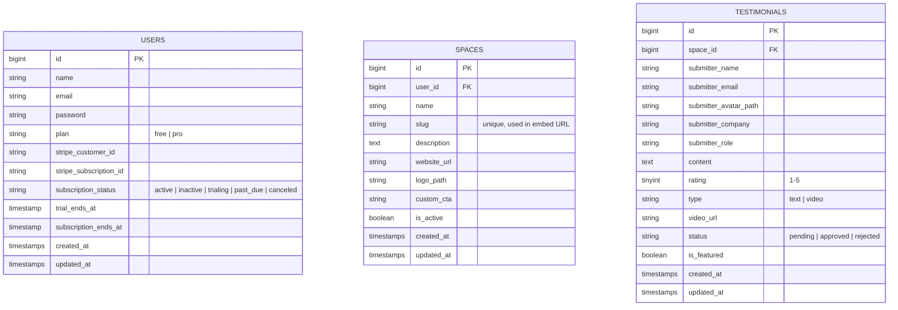

# Database Design – Testimonial SaaS

## Overview

This document outlines the database schema and Eloquent relationships for the core entities: **Users**, **Spaces**, and **Testimonials**. The business model follows a **Freemium Stripe** pricing structure.

---

## Pricing Tiers

| Tier | Price | Max Spaces | Max Testimonials / Space |
|------|-------|-----------|--------------------------|
| Free | $0/mo | 3 | 100 |
| Pro  | $9.99/mo | 25 | 1,000 |

---

## Entity-Relationship Diagram



---

## Table Definitions

### `users`

| Column | Type | Notes |
|--------|------|-------|
| `id` | `bigint` UNSIGNED PK | Auto-increment |
| `name` | `varchar(255)` | |
| `email` | `varchar(255)` | Unique |
| `email_verified_at` | `timestamp` | Nullable |
| `password` | `varchar(255)` | Hashed (bcrypt) |
| `plan` | `enum('free','pro')` | Default: `free` |
| `stripe_customer_id` | `varchar(255)` | Nullable |
| `stripe_subscription_id` | `varchar(255)` | Nullable |
| `subscription_status` | `enum('active','inactive','trialing','past_due','canceled')` | Default: `inactive` |
| `trial_ends_at` | `timestamp` | Nullable |
| `subscription_ends_at` | `timestamp` | Nullable |
| `remember_token` | `varchar(100)` | Nullable |
| `created_at` / `updated_at` | `timestamp` | |

> [!NOTE]
> `plan` is the source of truth for feature gating. It is updated via Stripe webhooks when a subscription is activated, cancelled, or changes.

---

### `spaces`

| Column | Type | Notes |
|--------|------|-------|
| `id` | `bigint` UNSIGNED PK | Auto-increment |
| `user_id` | `bigint` UNSIGNED FK | References `users.id`, cascades on delete |
| `name` | `varchar(255)` | |
| `slug` | `varchar(255)` | Unique; used in public embed/collection URL |
| `description` | `text` | Nullable |
| `website_url` | `varchar(255)` | Nullable |
| `logo_path` | `varchar(255)` | Nullable; stored in `storage/app/public` |
| `custom_cta` | `varchar(255)` | Nullable; CTA shown on testimonial collection page |
| `is_active` | `boolean` | Default: `true` |
| `created_at` / `updated_at` | `timestamp` | |

> [!IMPORTANT]
> **Free tier limit: 3 spaces per user.** Enforced at the application layer in the Space creation action/policy before inserting a record. Pro tier allows up to 25 spaces.

---

### `testimonials`

| Column | Type | Notes |
|--------|------|-------|
| `id` | `bigint` UNSIGNED PK | Auto-increment |
| `space_id` | `bigint` UNSIGNED FK | References `spaces.id`, cascades on delete |
| `submitter_name` | `varchar(255)` | |
| `submitter_email` | `varchar(255)` | Nullable |
| `submitter_avatar_path` | `varchar(255)` | Nullable |
| `submitter_company` | `varchar(255)` | Nullable |
| `submitter_role` | `varchar(255)` | Nullable |
| `content` | `text` | The testimonial body |
| `rating` | `tinyint` | 1–5; Nullable for video-only |
| `type` | `enum('text','video')` | Default: `text` |
| `video_url` | `varchar(255)` | Nullable; for video testimonials |
| `status` | `enum('pending','approved','rejected')` | Default: `pending` |
| `is_featured` | `boolean` | Default: `false`; used for "Wall of Love" highlight |
| `created_at` / `updated_at` | `timestamp` | |

> [!IMPORTANT]
> **Free tier limit: 100 testimonials per space. Pro tier: 1,000 per space.** Enforced at the application layer before inserting. Query `testimonials` count scoped to the space's owning user plan.

---

## Eloquent Relationships

### `User` Model

```php
// A user owns many spaces
public function spaces(): HasMany
{
    return $this->hasMany(Space::class);
}

// A user has many testimonials through spaces
public function testimonials(): HasManyThrough
{
    return $this->hasManyThrough(Testimonial::class, Space::class);
}

// Computed helpers
public function isProPlan(): bool
{
    return $this->plan === 'pro';
}

public function maxSpaces(): int
{
    return $this->isProPlan() ? 25 : 3;
}

public function maxTestimonialsPerSpace(): int
{
    return $this->isProPlan() ? 1000 : 100;
}
```

### `Space` Model

```php
// A space belongs to a user
public function user(): BelongsTo
{
    return $this->belongsTo(User::class);
}

// A space has many testimonials
public function testimonials(): HasMany
{
    return $this->hasMany(Testimonial::class);
}

// Convenience scopes
public function scopeActive(Builder $query): Builder
{
    return $query->where('is_active', true);
}
```

### `Testimonial` Model

```php
// A testimonial belongs to a space
public function space(): BelongsTo
{
    return $this->belongsTo(Space::class);
}

// Convenience scopes
public function scopeApproved(Builder $query): Builder
{
    return $query->where('status', 'approved');
}

public function scopeFeatured(Builder $query): Builder
{
    return $query->where('is_featured', true);
}
```

---

## Key Indexes

| Table | Index | Columns | Reason |
|-------|-------|---------|--------|
| `spaces` | `spaces_user_id_index` | `user_id` | Filter spaces by owner |
| `spaces` | `spaces_slug_unique` | `slug` | Public URL lookup |
| `testimonials` | `testimonials_space_id_index` | `space_id` | Filter by space |
| `testimonials` | `testimonials_status_index` | `status` | Filter approved/pending |
| `users` | `users_stripe_customer_id_index` | `stripe_customer_id` | Webhook lookup |

---

## Freemium Enforcement Strategy

> [!TIP]
> Enforce limits in a dedicated **Action class** (e.g., `CreateSpaceAction`, `CreateTestimonialAction`) rather than in controllers or Livewire components. This keeps the business rule in one place and makes it easy to test.

```php
// Example: CreateSpaceAction
class CreateSpaceAction
{
    public function execute(User $user, array $data): Space
    {
        if ($user->spaces()->count() >= $user->maxSpaces()) {
            throw new PlanLimitExceededException(
                "Upgrade to Pro to create more than {$user->maxSpaces()} spaces."
            );
        }

        return $user->spaces()->create($data);
    }
}
```
